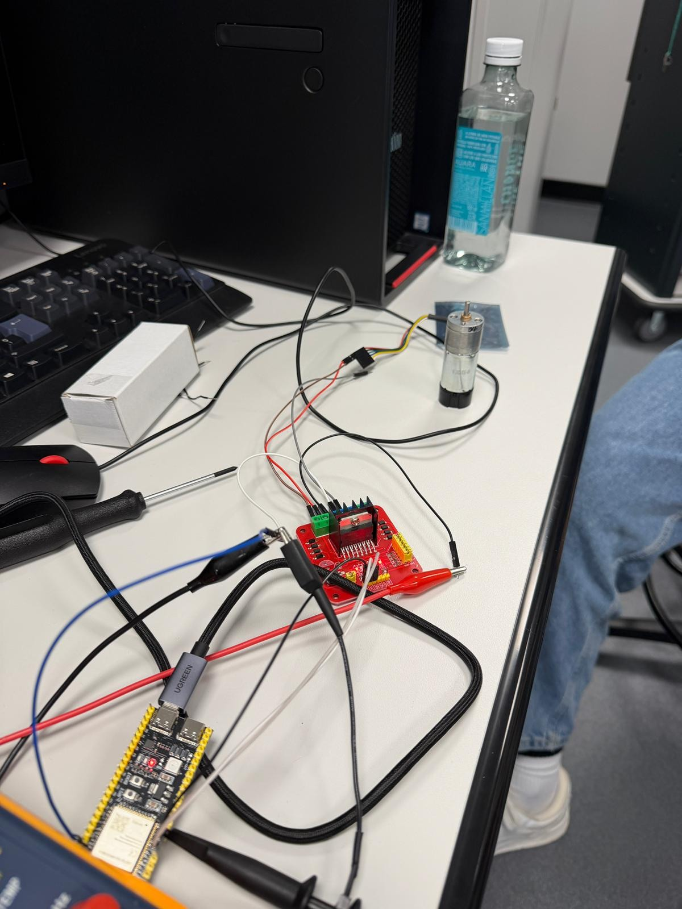
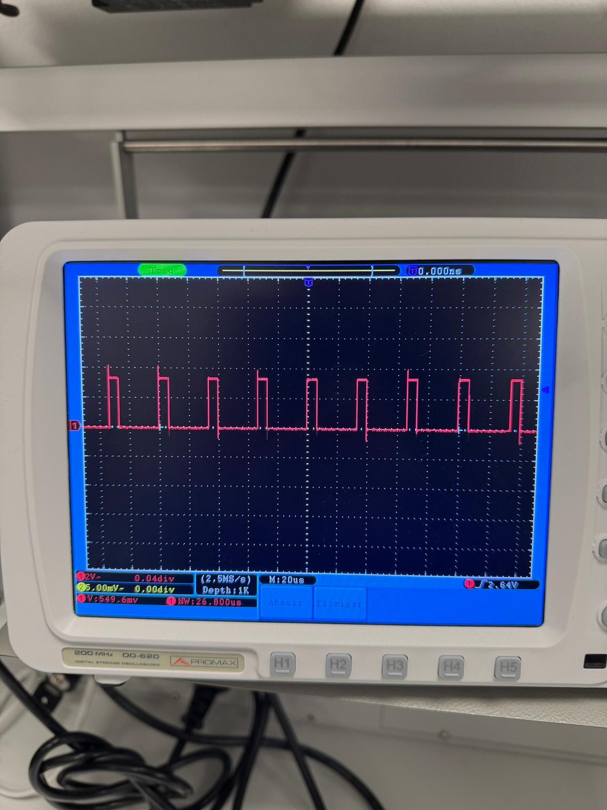
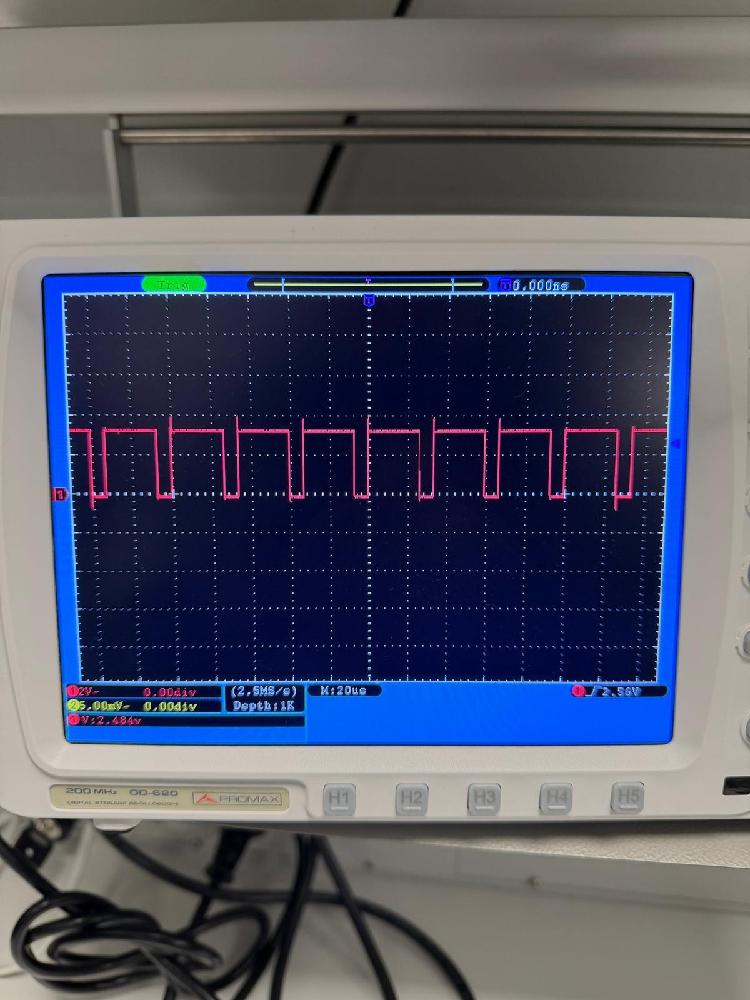

# DC Motor Control with ESP32-S3, L298N and Encoder

**Academic Engineering Project | Universidad Europea de Madrid | 2026**

## Project Overview

Development and physical testing of a DC motor control system using an ESP32-S3 microcontroller, an L298N H-bridge driver and a geared DC motor equipped with an incremental encoder.

The project integrates embedded programming, power electronics, digital signal acquisition and motor actuation.

The system receives commands through a serial interface to control motor direction, adjust PWM duty cycle and stop the motor. Encoder signals are acquired to monitor rotational movement.

The prototype was assembled and tested using physical laboratory equipment.

## Technologies and Equipment

| Component | Function |
|---|---|
| ESP32-S3 | Microcontroller and control logic |
| L298N | H-bridge motor driver |
| DC geared motor | Electromechanical actuator |
| Incremental encoder | Rotation and position feedback |
| 12 V power supply | Motor power |
| Oscilloscope | Electrical signal measurement |
| Arduino IDE | Firmware development |
| C++ / Arduino | Embedded programming language |

## System Architecture

The prototype consists of three interconnected blocks.

### 1. ESP32-S3 — Control Unit

The microcontroller executes the control program and manages communication with the computer.

Main functions:

- Receive commands through the serial interface.
- Generate PWM signals for motor actuation.
- Select motor direction using digital outputs.
- Acquire encoder pulses through interrupts.
- Track encoder position counts.
- Execute programmed movement sequences.

### 2. L298N — Power Stage

The L298N is an H-bridge driver that controls the electrical power delivered to the DC motor.

Main signals:

- **IN1:** motor direction control.
- **IN2:** motor direction control.
- **ENA:** PWM input for motor power modulation.

Changing the logical states of IN1 and IN2 reverses the motor's direction.

Changing the PWM duty cycle modifies the effective voltage applied to the motor.

### 3. DC Motor with Incremental Encoder

The motor converts electrical energy into mechanical rotation.

The encoder generates digital pulses that the ESP32-S3 processes to track rotational movement.

These measurements can support position monitoring and feedback-based control.

## Embedded Programming

The original firmware is written in C++ using the Arduino framework.

**[View original ESP32-S3 source code — PWM.ino](PWM.ino)**

### Pin Configuration

| Signal | ESP32-S3 GPIO |
|---|---|
| L298N IN1 | GPIO 4 |
| L298N IN2 | GPIO 5 |
| L298N ENA | GPIO 6 |
| Encoder A | GPIO 13 |
| Encoder B | GPIO 14 |

### PWM Configuration

The source code defines:

- PWM frequency: **30 kHz**
- PWM resolution: **8 bits**
- PWM command range: **0–255**

These values represent the programmed PWM configuration.

PWM duty cycle controls motor actuation, but it does not directly represent a calibrated speed in RPM.

### Serial Communication

The system uses a serial communication speed of **115200 baud**.

The implemented command interface includes:

| Command | Function |
|---|---|
| `F 200` | Forward rotation with PWM value 200 |
| `B 150` | Reverse rotation with PWM value 150 |
| `STOP` | Stop motor |
| `POS` | Display encoder position count |
| `G 90` | Request a relative rotation of 90 degrees |

The `G` command is implemented in the source code. Its positioning accuracy has not been independently validated in the published experimental evidence.

## Encoder Processing and Position Control

The ESP32-S3 reads encoder signals using an interrupt routine.

The firmware updates a position counter according to the observed states of the encoder channels.

The source code also contains a position-target routine that:

1. Calculates the target encoder count.
2. Compares the current count with the target.
3. Selects a direction of rotation.
4. Reduces the PWM command near the target.
5. Stops the motor within a programmed tolerance.

The position routine uses a tolerance of 15 encoder counts and begins reducing the PWM command within 200 counts of the target.

This is a feedback-based positioning approach, not a PID speed regulator.

The position counter is relative to the starting state and does not include an absolute homing reference.

## Physical Testing and Validation

The prototype was assembled using real electronic components and tested in a university laboratory.

The following functions were demonstrated:

- Physical DC motor operation.
- Forward and reverse rotation.
- Motor actuation at different PWM command values.
- Motor stopping through the programmed interface.
- Acquisition of encoder signals.
- Electrical signal observation using an oscilloscope.

The project demonstrates integration between embedded software, electronic hardware and a physical actuator.

No quantitative accuracy, efficiency or industrial reliability claims are made.

## Project Gallery

### 1. Physical Hardware Prototype

Real laboratory setup showing the ESP32-S3 development board, L298N motor driver, geared DC motor and experimental wiring.

### 2. Oscilloscope Measurement — Narrow Pulses

Experimental oscilloscope capture showing a pulsed electrical signal with a relatively short high-level duration.

### 3. Oscilloscope Measurement — Wide Pulses

Experimental oscilloscope capture showing a pulsed electrical signal with a longer high-level duration.

The captures document different pulse widths during laboratory experimentation.

The exact probe connections and measurement conditions have not been independently established from the photographs.

## Physical Demonstration Video

The following video was recorded during the laboratory tests of the motor control prototype.

**[Watch or download the original laboratory demonstration](https://github.com/CesarMalitaxi/esp32s3-dc-motor-control/raw/refs/heads/main/WhatsApp%20Video%202026-10-26%20at%2017.05.43.mp4)**

Original video filename:

`WhatsApp Video 2026-10-26 at 17.05.43.mp4`

The recording provides additional visual evidence of the physical experimental setup.

## Results and Engineering Skills

This project provided practical experience in:

- Embedded C++ programming.
- ESP32-S3 microcontroller configuration.
- PWM generation and motor actuation.
- H-bridge power electronics.
- Serial command processing.
- Encoder interrupts and position counting.
- Hardware-software integration.
- Oscilloscope measurements.
- Laboratory testing and debugging.

## Limitations and Future Improvements

The implementation is an academic laboratory prototype.

Current limitations include:

- No independently validated motor speed in RPM.
- No documented positioning accuracy measurements.
- No implemented PID speed regulator.
- No encoder homing or absolute position reference.
- The position-control routine has no timeout or movement-failure detection.
- The blocking position-control routine does not continuously process new serial commands.
- No long-duration industrial reliability testing.

Potential future improvements:

- Implement encoder-based speed estimation.
- Add PID speed regulation.
- Introduce movement timeouts and fault detection.
- Improve emergency stop handling.
- Calibrate encoder counts and validate positioning accuracy.
- Record experimental response and performance measurements.

## Academic Context

**Course:** Digital Electronics and Microprocessors

**University:** Universidad Europea de Madrid

**Academic year:** 2026

Academic project involving embedded programming, motor control, electronic integration and physical laboratory testing.

## Project Status

**Original firmware uploaded. Physical prototype tested.**

The repository contains:

- Original ESP32-S3 source code.
- Technical project documentation.
- Real hardware photographs.
- Oscilloscope measurements.
- Laboratory demonstration video.

The project is presented as an academic engineering prototype, not a production-ready industrial control system.
